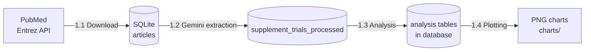
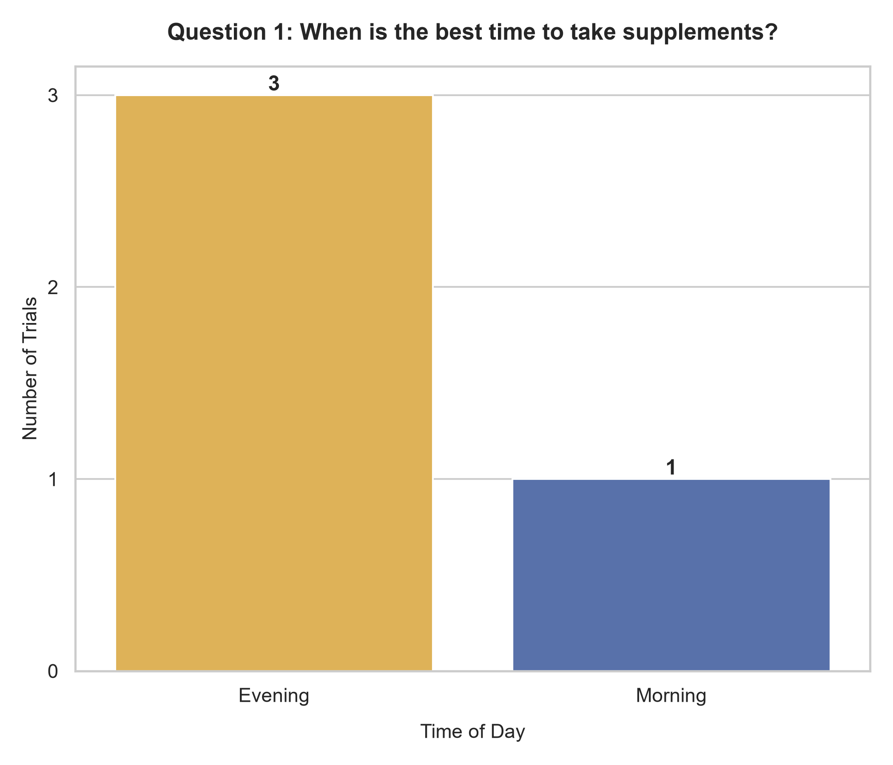
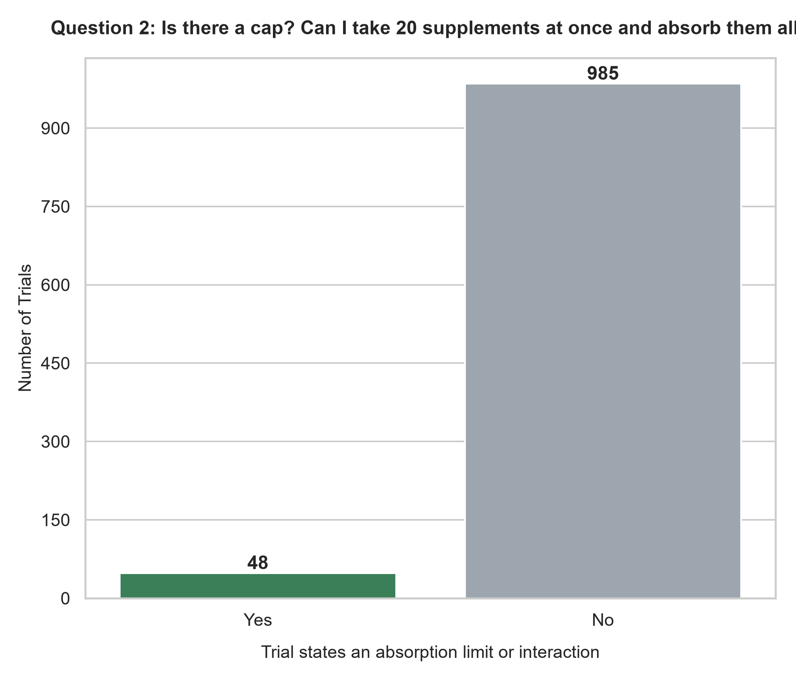
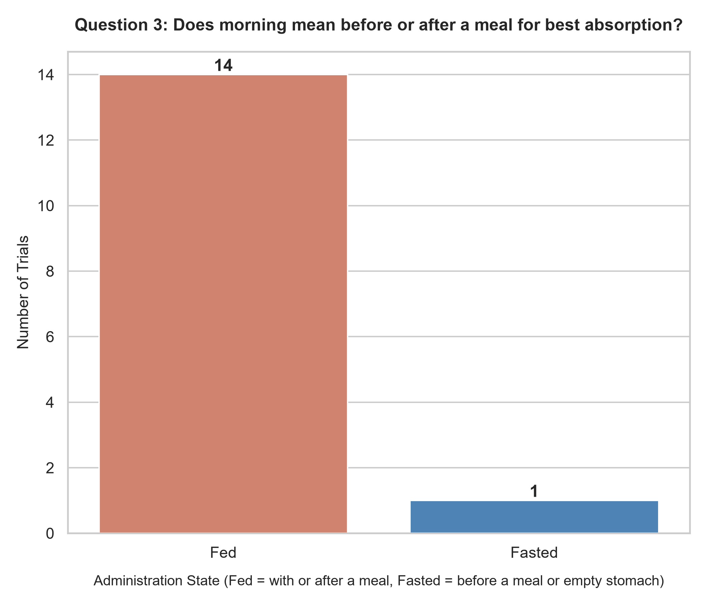

# 💊 Supplement Timing Research: Part 1 (Data Pipeline & Analysis)

> Mining 20 years of double-blind supplement trials from PubMed to ask: **when, and how, should you take your supplements?**


---

## 🎯 The Three Questions

| # | Question |
|---|----------|
| **Q1** | When is the best time to take supplements? |
| **Q2** | Is there a cap? Can I take 20 supplements all in the morning and get all of them absorbed? |
| **Q3** | Does "morning" mean before or after a meal for the best absorption? |

---

## 🗺️ Pipeline Overview



| Milestone | Script | What it does | Output |
|-----------|--------|--------------|--------|
| **1.1** Download | `pubmed_supplement_rcts.py` | Fetches double-blind RCTs on vitamins, minerals, omega fatty acids and amino acids (last 20 years) as XML and stores PMID, title, abstract and year | `articles`, `article_categories` tables |
| **1.2** Extract | `extract_supplements.py` | Sends each abstract to Gemini with a Pydantic schema and stores structured fields, one row per supplement per trial | `supplement_trials_processed` table |
| **1.3** Analyze | `analyze_supplements.py` | Aggregates the extracted data for each question, prints the summaries, and saves them as tables | `analysis_*` tables in the same database |
| **1.4** Visualize | `plot_results.py` | Draws one simple chart per question | PNG files in `charts/` |

---

## 📈 Results

> Charts are generated from the abstracts that have been processed so far, so counts grow as more abstracts go through Milestone 1.2.

### Q1: When is the best time to take supplements?



Shows how many trials gave the supplement in the morning versus the evening.

### Q2: Is there a cap?



Shows how many trials state an absorption limit or an interaction between supplements.

### Q3: Before or after a meal?



Shows how many trials gave the supplement fed (with or after a meal) versus fasted (before a meal or on an empty stomach).

### 🗃️ Supporting Analysis Tables

Milestone 1.3 prints its summaries and also saves them in `pubmed_supplements.db`:

| Table | Contents |
|-------|----------|
| `analysis_q1_timing_by_class` | Timing windows by supplement class |
| `analysis_q2_limits_interactions` | Trials stating limits or interactions, with supporting quotes and PMIDs |
| `analysis_q3_solubility_fed_fasted` | Fed vs. fasted counts and percentages by solubility group |

Query them like any other table, for example:

```sql
SELECT * FROM analysis_q3_solubility_fed_fasted;
```

---

## 🔍 What Gets Extracted

Gemini returns 20 fields per supplement. Any field can be empty when the abstract doesn't say; the prompt forbids guessing.

<details>
<summary><b>Show all fields</b></summary>

| Group | Fields |
|-------|--------|
| **Identity** | `supplement_name`, `chemical_class`, `supplement_form` |
| **Q1: timing** | `timing_window` (Morning / Evening / Split-Dose / Pre-Workout / Other), `timing_detail`, `dosing_frequency`, `compared_timings` |
| **Q2: cap** | `dose_per_administration`, `total_daily_dose`, `absorption_limit_stated`, `co_administered_supplements`, `interactions_noted` |
| **Q3: meals** | `administration_state` (Fed / Fasted), `meal_timing_detail`, `meal_contained_fat` |
| **Outcome** | `outcome_measured`, `better_condition` |
| **Evidence** | `timing_evidence`, `meal_evidence`, `limit_evidence` (short verbatim quotes from the abstract) |

</details>

---

## 🚀 Quick Start

### 1. Install

```bash
pip install biopython pandas matplotlib seaborn google-genai pydantic python-dotenv
```

### 2. Configure

Create a `.env` file in the project folder (no quotes, no spaces around `=`):

```
NCBI_EMAIL=you@example.com
NCBI_API_KEY=your_ncbi_key_optional
GEMINI_API_KEY=your_gemini_key
GEMINI_MODEL=gemini-3.5-flash
```

### 3. Run each milestone

```bash
python pubmed_supplement_rcts.py          # 1.1  download (skips if fetched within 90 days)
python extract_supplements.py --limit 25  # 1.2  test run on 25 abstracts
python extract_supplements.py --all       # 1.2  process every pending abstract
python analyze_supplements.py             # 1.3  analysis (prints + saves tables)
python plot_results.py                    # 1.4  charts
```

---

## ⚙️ Design Notes

- **Resumable extraction.** Every abstract is logged in `extraction_log` (`done`, `no_abstract`, or `error`). Re-running `--all` skips finished abstracts and retries failed ones, so a stop or a rate limit never loses work.
- **Download is idempotent.** PMID is the primary key, so re-fetching never creates duplicates. A `fetch_log` table skips the download if one finished in the last 90 days.
- **Small batches.** PubMed records are fetched 200 at a time and committed per batch, which keeps memory flat.
- **One source of truth.** Everything lives in `pubmed_supplements.db`. Analysis (1.3) saves its summaries as tables there, and charting (1.4) only draws charts from the database, so no results are scattered across files.
- **Evidence over guesses.** Each extracted value comes with a short quote from the abstract, so it can be checked by hand.
- **Cost-aware.** Extraction calls the Gemini API per abstract. Use `--limit` for test runs before processing everything.

---

## ⚠️ Limitations

- **Most abstracts don't say.** Few trial abstracts state when the supplement was taken, whether it was with food, or any absorption limit, so many fields are empty and the charts are based on a small subset.
- **Charts show how trials were run, not what works best.** A tall "Fed" bar means researchers usually gave supplements with food, not that this is more effective. Only trials that directly compared timings (`compared_timings`) can speak to "best".
- **Q2 "No" doesn't mean no limit.** It means the abstract didn't mention one.
- **Not medical advice.** This is an educational data project. Please check with a doctor or pharmacist before changing how you take supplements.

---

## 🗂️ Project Structure

```
.
├── pubmed_supplement_rcts.py    # Milestone 1.1: download
├── extract_supplements.py       # Milestone 1.2: Gemini extraction
├── analyze_supplements.py       # Milestone 1.3: analysis (prints + saves tables)
├── plot_results.py              # Milestone 1.4: charts only
├── pubmed_supplements.db        # SQLite database: the single source of truth
├── charts/                      # PNG charts
└── .env                         # API keys (do not commit)
```

---

## 🔭 What's Next

- **Part 2: Machine learning.** Train a scikit-learn classification / decision-tree model on the extracted data (supplement chemistry, molecular weight, lipophilicity, dose size) to predict timing window, fed or fasted state, and a single-dose cap.
- **Part 3: Inference.** A FastAPI + Streamlit app where you enter something like `Fish oil, 2000mg` and get back a suggested time of day, meal pairing, and a dose-limit check.

With scarce labeled data, Part 2 is expected to show low accuracy. That is part of the lesson, and its results will be reported against a baseline.
